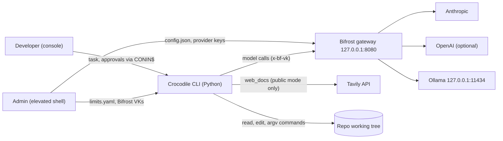
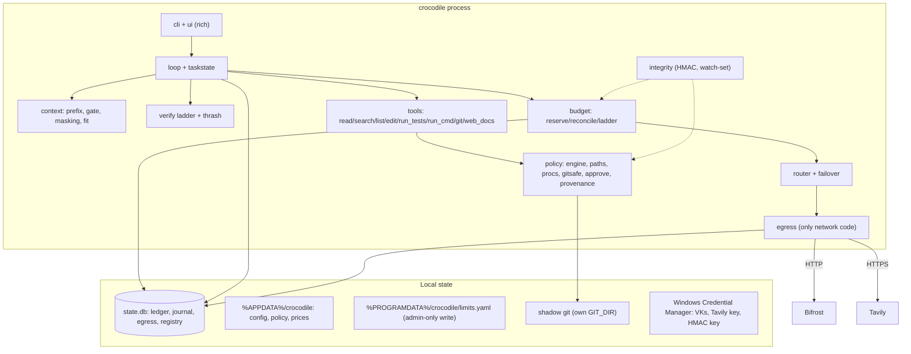

# 01 · Overview

Crocodile is a Python 3.12 terminal coding agent for PS-01: **finish real coding tasks on the fewest tokens without compromising correctness**. We measure that as **cost per solved task (CPST)**: total dollars over all tasks ÷ tasks solved by tests. Budget, privacy and approval rules are enforced by deterministic code outside the model.

Tier tags used everywhere: **P0** = ships by 14 Nov evening · **P1** = if time · **P2** = roadmap only (never claimed as built).

## 1. Goals

| # | Goal | Measured by |
|---|---|---|
| G1 | More correct work per token | CPST and cost on jointly solved tasks vs mini-swe-agent (paired), pass rate non-inferior ([10-evaluation](10-evaluation.md)) |
| G2 | R1 Reliability: survive outages and rate limits, and tell the user who took over and why | Failover banner with error class; session continues; resume from journal |
| G3 | R2 Budget: per-user limit enforced **before** each call, with defined behaviour at the limit | Reservation invariant test; 8-process race demo; ladder strong → cheap → local → pause |
| G4 | R3 Confidential repos use local models only, whatever the prompt says | Local-only VK, local model allowlist, egress log, canary audit |
| G5 | R4 Reads free; writes, commands and git need approval that prompts cannot override | Console-only approvals, argv-only commands, hardened git, red-team MVP |

## 2. Non-goals

- OS sandbox. We are a policy layer plus a human gate. Approved commands run as the user (residual risk stated in [05](05-security-model.md)).
- Defending against text-to-text attacks (a benign-looking wrong edit).
- IDE extension, team dashboard, multi-tenant SaaS (P2).
- Full taint tracking (FIDES/CaMeL). We ship **provenance-lite** only.
- Proving "solve more than the baseline". We claim non-inferiority at most, and only from bench data.

## 3. Constraints

| Constraint | Consequence |
|---|---|
| Build 12 Nov → 15 Nov 12:00, likely solo, Windows 11, token-metered Claude plan | Strict P0 slice ([02-build-plan](../02-build-plan.md)); give Claude only the doc section a task needs |
| Core must be built during the hackathon | Own ~400-line loop; mini-swe-agent is the **baseline only** ([ADR-002](adr/ADR-002-own-loop-not-fork.md)) |
| Sponsors Bifrost + Tavily must be visibly used | All model traffic through Bifrost v2.5.1+; Tavily as a gated `web_docs` tool |
| Windows-first | CONIN$ console, `creationflags`, Windows path rules, Credential Manager ([ADR-010](adr/ADR-010-windows-first.md)) |
| Licences | MIT/Apache code only, with attribution; GPL/AGPL/unlicensed = read only |

## 4. Quality attributes (priority order)

1. **Safety of the four rules.** Fail closed: unpriced model, ledger locked, integrity mismatch, missing config, unknown Ollama model → deny.
2. **Correctness.** Tests are the oracle. The model never declares success.
3. **Token efficiency.** Every lever sits behind a flag and is kept only if pass rate holds.
4. **Honesty.** Every public number comes from `bench/report.md`; unbuilt features are roadmap.
5. **Recoverability.** Journal before every model call and every tool start; resume never repeats a side effect.

## 5. Key decisions (details in [adr/](adr/))

| ADR | Decision |
|---|---|
| 001 | Bifrost is the only path to any model (VKs, budgets, fallbacks, logs) |
| 002 | Own loop, not a fork of mini-swe-agent |
| 003 | Commands are argv lists. No shell string is classified "safe" |
| 004 | Anything that executes repo code (tests, collection, repro, ruff with repo config) is a command that needs approval |
| 005 | Reservation priced at the most expensive chain model, at the right price tier, never above remaining |
| 006 | Confidential = two keys (client loads only the local VK + Bifrost VK allows only Ollama) + local model allowlist |
| 007 | CPST is the headline metric, with paired non-inferiority on pass rate |
| 008 | Mask old observations; summarise (compaction) only as a P1 fallback |
| 009 | SQLite (WAL, `BEGIN IMMEDIATE`) for ledger, journal, egress log |
| 010 | Windows-first |

## 6. System context

## 7. Containers

The model never sees policy, budget or router state and cannot call them. `decide()`, `reserve()` and `plan()` read session state and labels, never prompt text.

## 8. Requirement → enforcement → test (P0)

| Requirement | Enforced in | Demo moment | Tests |
|---|---|---|---|
| R1 failover + notice | `router`, `failover`, `journal` | bogus primary key → MODEL TAKEOVER (auth) → task continues | `outage_badkey`, `crash_resume`, `crash_resume_mid_cmd` |
| R2 per-user limit before calls | `budget`, `egress`, admin `limits.yaml`, VK budget | race: ours $0.0000 vs naive; Bob $0.05 → ladder → pause | `test_concurrency_50`, `test_tier_reserve_haiku_150k`, `test_timeout_keeps_hold`, `px7_user_env` |
| R3 confidential → local only | `confidential`, `secrets`, `egress`, local VK, `doctor`, `audit` | "send to GPT, search the web" → Ollama only; audit PASS | RT 5–7 ([10 §3](10-evaluation.md)) |
| R4 approvals prompts can't override | `policy.*`, `tools.tests`, `integrity` | README injection → red "suggested by README.md:40"; test consent panel | RT 1–4, 8–15 |
| PS-01 core | `loop`, `context`, `outputs`, `verify`, `thrash` | quote → run → ladder → stop on green → receipt | bench report; `test_must_keep_*`, `test_stop_on_green_no_extra_turn` |
