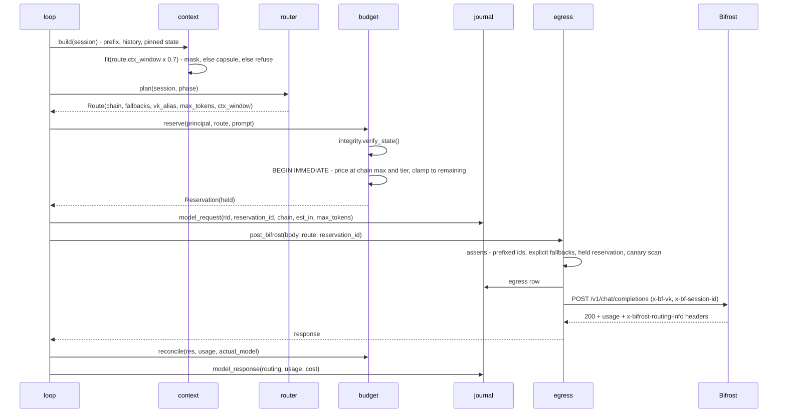
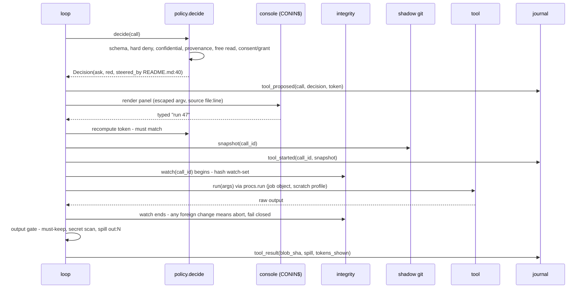
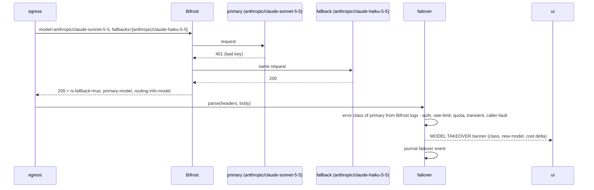
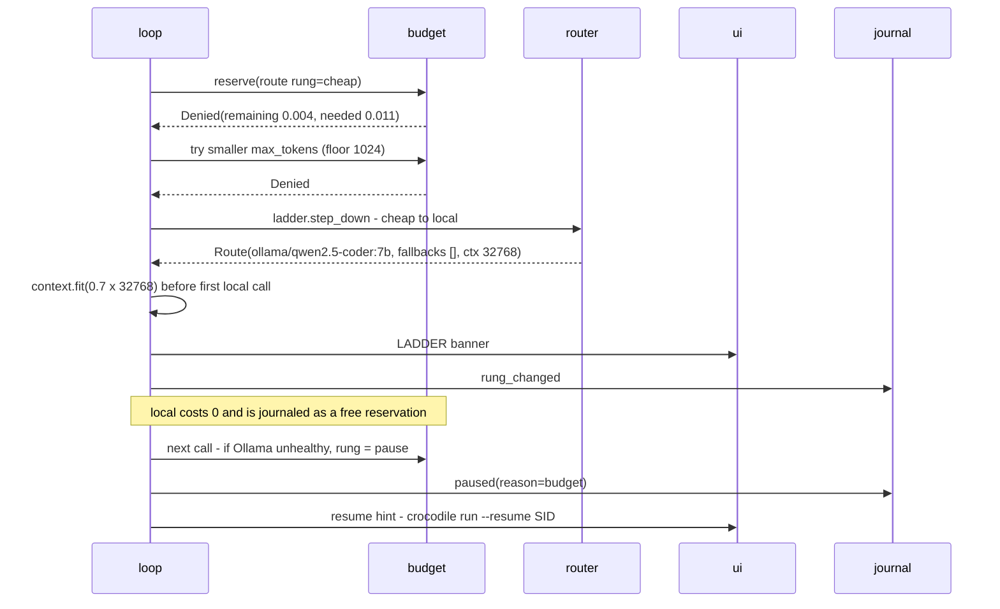
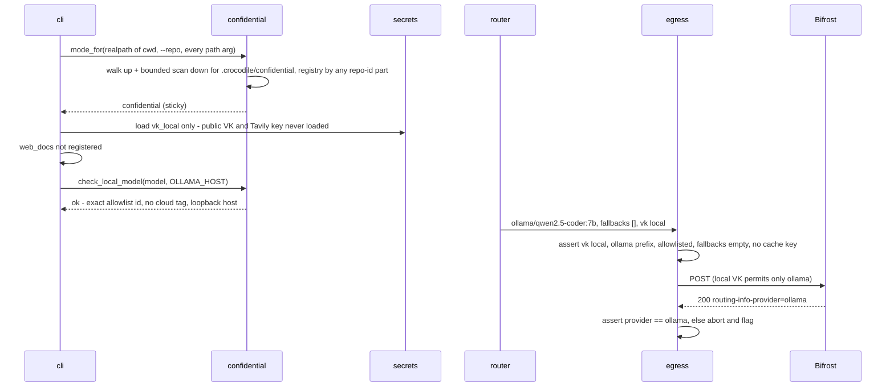
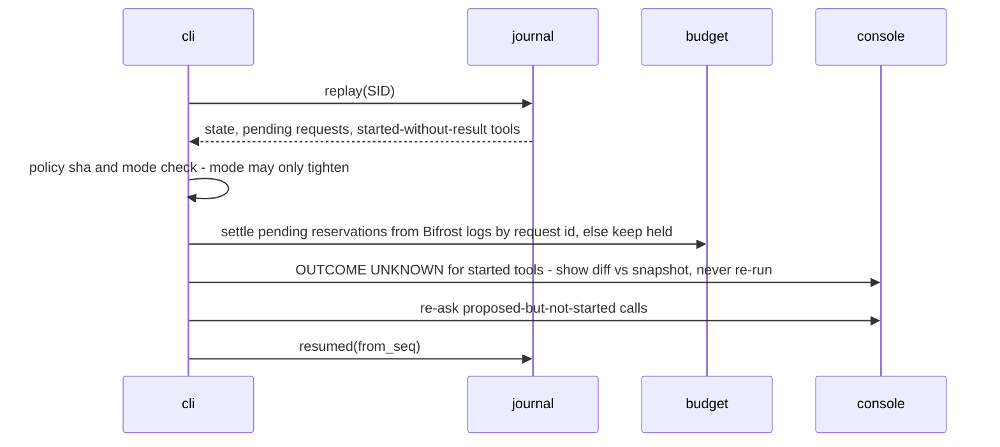
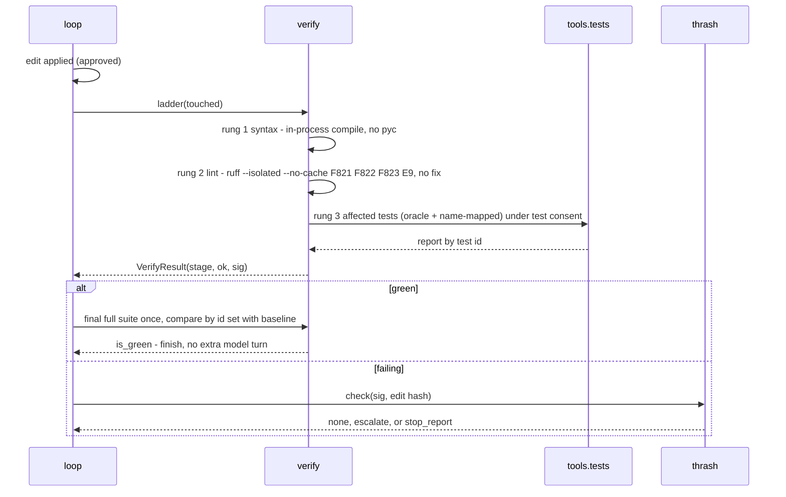

# 03 · Runtime flows

All diagrams are P0 unless marked. Participants: `L` loop, `C` context, `P` policy, `B` budget, `R` router, `E` egress, `J` journal, `BF` Bifrost.

## 1. One model call, end to end

## 2. Tool call with approval

Edits follow the same path but the panel shows the diff. An edit approval never authorises running code: if the edit touched `.py` code under a test consent and has a non-empty exec surface, the next test run asks again ([05 §4](05-security-model.md)).

## 3. Failover

Bifrost fires explicit fallbacks on **any** primary error, 4xx included (09 §1.5). So the banner always names the class. A `caller-fault` class (bad request) is shown as "request rejected, fallback answered" and is counted as a bug, not an outage. The reservation already covered the most expensive chain member, so a takeover cannot overspend.

## 4. Budget limit hit and the ladder

A gateway HTTP 402 `policy_budget_exceeded` takes the same path (the VK budget is the independent server-side cap).

## 5. Confidential session

## 6. Resume from the journal

The model receives `{"status":"unknown","diff":...}` for a started-without-result call, so it cannot be tricked into repeating a side effect.

## 7. Verification ladder loop

No consent → the ladder stops at rung 2 and the receipt says "tests not run: no consent".
