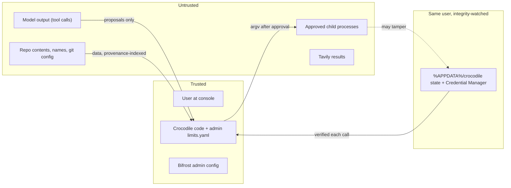

# 05 · Security model

## 1. Trust boundaries

The model only proposes typed tool calls. Deterministic code decides. The policy engine reads tool arguments and session state, never prompt text.

## 2. Policy engine (`policy/engine.decide`, P0)

First match wins:
1. **Schema.** Unknown tool or extra field → DENY.
2. **Hard deny.** Path fails `resolve_in_repo`; write to a protected path; banned git option or invalid rev; `.bat`/`.cmd` argument with `& | < > ^ % " \n \r`; exe resolved inside the repo; `crocodile` itself as `argv[0]` (so `init --public` cannot run via a command).
3. **Confidential.** Confidential session and a NET sink (Tavily, `git push`, `pip install`, any URL arg) → DENY. Every EXEC → red with "network is not blocked for child processes".
4. **Provenance.** `steered_by` non-empty and NET → DENY; with EXEC/WRITE/GIT_MUT → red naming `file:line`.
5. **Free read.** `read`, `search`, `list`, git read templates (after the per-call config check) → ALLOW.
6. **Consent / grant.** Exact consented test argv with valid consent → ALLOW (journaled `by: consent`).
7. **Default ASK** with a risk level.

| Level | Trigger | Prompt |
|---|---|---|
| green | edit with empty exec surface, ≤ 3 files, not a red path | batch "apply 2 edits? [y/N]" |
| amber | any EXEC; edit with exec surface; git mutation; multi-file | diff or escaped argv + resolved exe + cwd; `[y/N]` |
| red | steered; red path (tests, conftest, CI, build config); irreversible git; confidential EXEC; test consent | full panel; type the shown word + 2-digit nonce (`run 47`) |

Green defaults to **N** (review 07 H1). `--yes-green` never combines with test execution.

## 3. Approvals (`policy/approve.py`, P0)

- Read only from the console: `CreateFile("CONIN$")` / `msvcrt.getwch()`. `sys.stdin` is ignored, so `yes |` approves nothing. Pending keys are drained before each prompt. No console → deny everything except the bench profile.
- **Escaping renderer:** ANSI/OSC, `\r`, bidi (`‮`), zero-width and other non-printables are shown as red `\uXXXX`. Long values are capped with "+N chars".
- **Approval token** = `sha256(tool, argv or diff, resolved exe path + size + mtime, resolved paths + pre-image hashes, cwd)`, recomputed right before execution. Mismatch → refuse and re-prompt. P1 adds sha256 of repo scripts named in argv (review 07 M4).
- **Bench profile** (only via `crocodile bench`, in a throwaway copy): auto-approves edits and the exact test argv; denies `run_cmd`, git mutations, `web_docs` and red edits.

## 4. Code execution (ADR-003, ADR-004)

- `run_cmd(argv: list[str], cwd_rel=".")` runs `subprocess.run(argv, shell=False)` after `resolve_exe`. There is no "read-only shell" class. If `argv[0]` is a shell or interpreter with `-c`/`/c`/`-Command`, the script is shown verbatim (escaped) with "⚠ unparsed script" (tree-sitter explainer is P1).
- **Anything that executes repo code is a command needing approval:** pytest (incl. `--collect-only`), the repro/oracle run, the baseline run, the verification ladder's test rung, and ruff with repo config. `quote` executes nothing (static scan).
- **Test consent:** once per session, a red panel "THIS EXECUTES CODE FROM THE REPO" shows the exact test argv, the interpreter, and every config file found by a static scan (`conftest.py` at every level, `pytest.ini`, `tox.ini`, `setup.cfg`, `pyproject [tool.pytest*]`, `addopts`, `-p`, `pytest_plugins`) with hashes. Approval stores a `test_consent` grant.
- Consent is voided by a change to any hashed config file, by a steered argv, or by an applied edit whose **exec surface** is non-empty (AST check of the REPLACE side for `os.system/exec*/spawn*`, `subprocess`, `socket`, `urllib`, `http.client`, `requests`, `httpx`, `ctypes`, `winreg`, `eval`, `exec`, `compile`, `__import__`, `importlib`, `pickle.loads`, `marshal`, `shutil.rmtree`). The next run then asks again, showing "will execute edited code".
- pytest runs with `-p no:cacheprovider` and `PYTEST_DISABLE_PLUGIN_AUTOLOAD=1`. `conftest.py` still runs, by design, which is why consent exists.
- Ruff in the ladder: `ruff check --isolated --no-cache --select F821,F822,F823,E9 --output-format json` (no repo config, no writes). Optional autofix (`layers.lint_fix`, P1) runs `ruff check --isolated --fix-only --stdin-filename f -` and shows the result as a green diff to approve.

## 5. Hardened git (`policy/gitsafe.py`, P0)

- Absolute `git.exe` resolved outside the repo. Every call: `--no-pager` and `-c core.fsmonitor=false -c core.hooksPath=<empty dir> -c core.pager=cat -c diff.external= -c core.sshCommand= -c credential.helper= -c protocol.ext.allow=never -c core.editor=false -c core.askPass= -c core.attributesFile=NUL`, plus `-c filter.<name>.{process,clean,smudge}= -c filter.<name>.required=false` for every driver named in any attributes file. Env: `GIT_CONFIG_NOSYSTEM=1`, `GIT_CONFIG_GLOBAL=NUL`, `GIT_TERMINAL_PROMPT=0`, all other `GIT_*` dropped. `diff/log/show` add `--no-ext-diff --no-textconv`.
- **Per-call config check (review 07 H5):** before every git call, hash `.git/config`, `.git/info/attributes` and worktree `.gitattributes`. On change, re-run the audit (`git config --file <gitdir>/config --no-includes --list` against an allowlist of `core.*` basics, `remote.*.{url,fetch}`, `branch.*`, `user.*`). Any other key → free git off for the session, banner names the keys.
- **Model strings:** every rev passes `validate_rev` (`^(?!-)[A-Za-z0-9_./~^@{}:-]{1,200}$`, then `rev-parse --verify --end-of-options REV^{commit}` and the SHA is used). `N` is an int in [1, 200]. `--end-of-options` before revs, `--` before paths. Option prefixes (`--output*`, `--upload-pa*`, `-c`, `--exec*`, `-C`, `--git-dir`, `--work-tree`, `--config-env`, `-O`, `--paginate`, `--no-index`) are denied in any position.
- Mutations: commit/checkout/restore/stash/switch → amber; `reset --hard`, `clean -fdx`, `branch -D`, `push` → red; push with a steered URL or in confidential mode → DENY.

## 6. Windows specifics (`policy/paths.py`, `policy/procs.py`, P0)

- `NoDefaultCurrentDirectoryInExePath=1`; `resolve_exe` searches PATH minus `.`, relative entries and anything under the repo/cwd. `git`, `rg`, `ruff`, `python` pinned at session start.
- `resolve_in_repo`: reject NUL, `\\?\`, `\\.\`, UNC, any `:` after the drive (ADS), device names (`CON`, `NUL`, `COM1`…); strip trailing dots/spaces per component; `realpath` (junctions, symlinks, 8.3); `normcase` + `commonpath`; protected-set match also on intermediate reparse points; writes refuse `st_nlink > 1` and use temp file + `os.replace`. In a public session, any path under a confidential subtree → DENY (also applied to `search` results).
- Spawn: `shell=False`, `stdin=DEVNULL`, `CREATE_NO_WINDOW | CREATE_NEW_PROCESS_GROUP`, timeout 120 s, a **job object with KILL_ON_JOB_CLOSE and no breakaway**, closed when the main child exits, so no daemon survives.
- Child env built from an allowlist (`PATH` sanitised, `SYSTEMROOT`, `WINDIR`, `COMSPEC`, `PATHEXT`, `PYTHONUTF8=1`, …). `APPDATA`, `LOCALAPPDATA`, `USERPROFILE`, `HOMEPATH`, `TEMP`, `TMP` point to a per-call scratch dir `%LOCALAPPDATA%\crocodile\sbx\<call_id>\`. No VKs, `*KEY*`, `*TOKEN*`, `*SECRET*`, `ANTHROPIC_*`, `OPENAI_*`, `TAVILY_*`, proxy vars.
- Secrets: `search` runs rg with `--glob !<pattern>` per `read_redact` entry plus a path post-filter; the output gate's secret scanner replaces AKIA…, `ghp_`/`github_pat_`, `sk-`, `xox[bp]-`, PEM blocks, `://user:pass@`, JWTs and high-entropy `*_KEY/_TOKEN/_SECRET` values with `[REDACTED:<kind>:<sha8>]` in every tool result.

## 7. Provenance-lite (P0)

Every untrusted result (file text, search lines, names, command output, web results) is added to a `ProvenanceIndex` with `file:line`. Before deciding a call, each sensitive field (argv elements, URLs, hosts, git remotes/refspecs, `web_docs` query, and URLs/hosts/new imports in an edit's REPLACE side) is checked: a value of ≥ 8 chars, or any URL/host, that appears **literally** in untrusted text read this session and **not** in the user's task text → `steered_by`. The red panel names the first source, e.g. "suggested by README.md:40". No label lattice, no wallet (P2).

## 8. State integrity (`integrity.py`, P0, review 07 C2)

- **Key:** a 32-byte HMAC key in Windows Credential Manager (`keyring`, DPAPI-backed), created by `crocodile init`.
- **Database:** after each agent write, `meta.hmac = HMAC(key, digest(ledger rows of the current window, confidential_repos, grants))`. `verify_state()` runs before every `reserve` and every tool decision. Mismatch → fail closed: refuse calls, red banner, `integrity_violation` event.
- **Watch-set:** before and after every EXEC/GIT_MUT, hash `config.yaml`, `policy.yaml`, `prices.yaml`, `state.db` HMAC, the empty-hooks dir, `<repo>\.git\config`, `.git\hooks\*`, `.git\info\attributes`, `.gitattributes`, `.gitmodules`, `.crocodile\**`. A change the agent did not make → abort the session.
- **Sticky confidential:** a repo id seen confidential in any journal `session_started` stays confidential even if its registry row disappears.
- **Independent caps:** the Bifrost VK budget enforces the limit server-side regardless of local state. Per-user limits live in admin-only `limits.yaml`; users cannot raise them; `budget set` is admin-only.
- **Residual risk (stated honestly):** any same-user process can read the Credential Manager key, recompute HMACs, read VKs and call Bifrost directly. Integrity checks catch careless or generic tampering by an approved child, not a targeted same-user attacker. **P2:** run children under a restricted Low-integrity token or a separate OS user, and host Bifrost under a service account.

## 9. Threat model

| # | Threat | Control | Enforcement point | Test | Tier |
|---|---|---|---|---|---|
| T1 | Prompt injection via README/comments/web suggests a command | Provenance-lite → red typed approval naming file:line | `provenance`, `engine`, `approve` | `rt_readme_curl` | P0 |
| T2 | Shell-string chaining (`&`, newline, `$()`) | argv-only; no string is ever "safe"; script shown verbatim | `tools/cmd`, `engine` | `rt_amp_newline` | P0 |
| T3 | Tests/collection/ruff run repo code without approval | Test consent; exec-surface re-prompt; quote static | `tools/tests`, `verify`, `quote` | `rt_quote_no_exec`, `rt_ladder_requires_consent`, `rt_green_edit_then_tests` | P0 |
| T4 | Approved child tampers with agent state, ledger, registry, `.git/config` | HMAC + watch-set, scratch profile, job object, admin limits, VK cap | `integrity`, `procs` | `rt_child_edits_ledger`, `rt_child_deletes_registry` | P0 |
| T5 | Ollama cloud model or remote host in confidential mode | Exact allowlist, `:cloud`/`-cloud` reject, loopback `OLLAMA_HOST`, doctor | `confidential`, `egress`, `doctor` | `px_ollama_cloud_tag` | P0 |
| T6 | Confidential repo missed (`--repo` from elsewhere, nested subtree, marker deleted) | realpath walk up from every path + bounded scan down; sticky registry + journal | `confidential`, `paths` | `px3_repo_flag`, `px3_nested`, `px3_marker_deleted` | P0 |
| T7 | Cloud key or Tavily in a confidential process | Only `vk_local` loaded; `web_docs` unregistered; egress asserts | `secrets`, `egress` | `px1_use_gpt`, `px4_tavily` | P0 |
| T8 | Git runs repo config (fsmonitor, filters, `--output`) | Hardened runner, per-call audit, rev validation, option denial | `gitsafe` | `rt_fsmonitor`, `rt_template_rev` | P0 |
| T9 | Binary planting (repo `git.bat`, `rg.exe`) | Absolute exe outside repo, stat in token | `procs` | `rt_planted_git` | P0 |
| T10 | Path aliasing (junction, `.git.`, ADS, 8.3, device) | `resolve_in_repo` | `paths` | `rt_paths_windows` | P0 |
| T11 | Secrets reach the cloud via `search`/`read` | rg globs, redact list, content secret scanner | `tools/search`, `outputs` | `sec_rg_env`, `sec_gitconfig_token` | P0 |
| T12 | Reward hacking: model edits tests/conftest or adds skip | Oracle freeze; test paths red; green needs id-set comparison and no new skip/xfail; bench restores tests | `verify`, `engine`, `bench/grade` | `test_oracle_edit_red`, `test_skip_not_green` | P0 |
| T13 | Budget overshoot (parallel, tiers, retries, timeouts) | Reservation at chain max + tier, lease, hold on timeout, egress requires reservation | `budget`, `egress` | `test_concurrency_50`, race demo, `test_tier_reserve` | P0 |
| T14 | User raises own limit / identity by env var | Admin-only limits, principal = VK hash | `config`, `budget` | `px7_user_env`, `test_budget_set_non_admin` | P0 |
| T15 | Piped or spoofed approvals; ANSI/bidi tricks | CONIN$ only, escaping renderer, nonce | `approve` | `pipe_yes`, `rt_ansi_argv` | P0 |
| T16 | TOCTOU between approval and execution | Approval token recomputed pre-exec | `approve`, `fs` | `rt_swap_after_preview` | P0 |
| T17 | Resume repeats a side effect | `tool_started` before spawn; OUTCOME UNKNOWN on resume | `journal`, `loop` | `crash_resume_mid_cmd` | P0 |
| T18 | Silent truncation on local step-down | `OLLAMA_CONTEXT_LENGTH`, fit to 0.7 × ctx or refuse | `context`, `router`, `doctor` | `test_stepdown_fits_window` | P0 |
| T19 | Exfil by an approved command or test | Approval, env allowlist; **no OS sandbox** | `procs` | documented residual | P2 |
| T20 | Same-user process steals VK / key | Credential Manager, VK budget cap | `secrets`, Bifrost | documented residual | P2 |

Out of scope: OS sandboxing, text-to-text attacks, code that runs only when the user later runs it.
