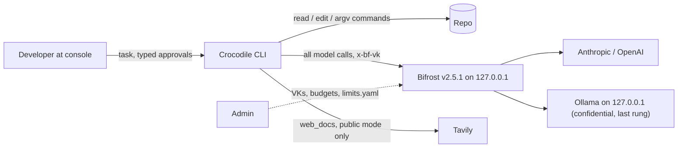

# Crocodile architecture (v5)

Single source of truth for how Crocodile is built. The old `DESIGN.md` (v4.1) was split into these files on 12 Nov 2026; see [CHANGELOG](CHANGELOG.md).

## Index

| File | What it answers |
|---|---|
| [01-overview](01-overview.md) | Goals, non-goals, constraints, quality attributes, key decisions, context + container diagrams |
| [02-components](02-components.md) | Module layout, responsibilities, public interfaces, P0/P1/P2 per module |
| [03-runtime-flows](03-runtime-flows.md) | Sequence diagrams: model call, approval, failover, ladder, confidential, resume, verification |
| [04-data-model](04-data-model.md) | File locations, labels, SQLite schema, journal events, config/policy/limits, prices, Bifrost `config.json` |
| [05-security-model](05-security-model.md) | Trust boundaries, policy engine, approvals, code execution, git, Windows, provenance, integrity, threat table |
| [06-budget-and-reliability](06-budget-and-reliability.md) | Reservation, hard-cap semantics, identity, ladder, failover, journal and resume |
| [07-confidential-mode](07-confidential-mode.md) | Detection, two keys, local model allowlist, egress log, canary audit, Tavily off |
| [08-token-and-accuracy-engine](08-token-and-accuracy-engine.md) | Token levers and accuracy levers, each tagged P0/P1/P2 |
| [09-bifrost-and-tavily](09-bifrost-and-tavily.md) | Exactly how we use both sponsors; verified vs unverified facts |
| [10-evaluation](10-evaluation.md) | Paired bench vs mini-swe-agent, red-team MVP, scorecard |
| [11-cli-ux](11-cli-ux.md) | Commands and mock outputs |
| [adr/](adr/) | ADR-001 … ADR-010 |

**Tiers:** P0 ships by 14 Nov evening; P1 if time; P2 roadmap only. Nothing P1/P2 is claimed in public material until it exists ([03-claims](../03-claims.md)).

## System context

The model proposes; deterministic code decides. Policy, budget and router never read prompt text, and the model cannot call them.
